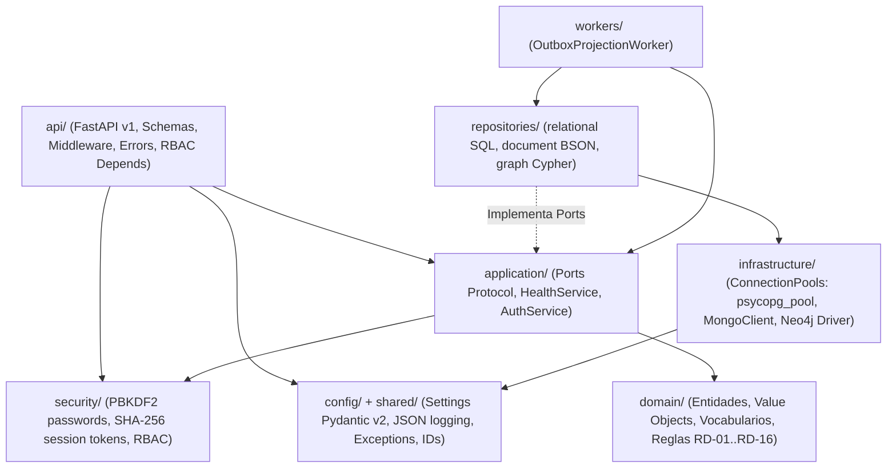
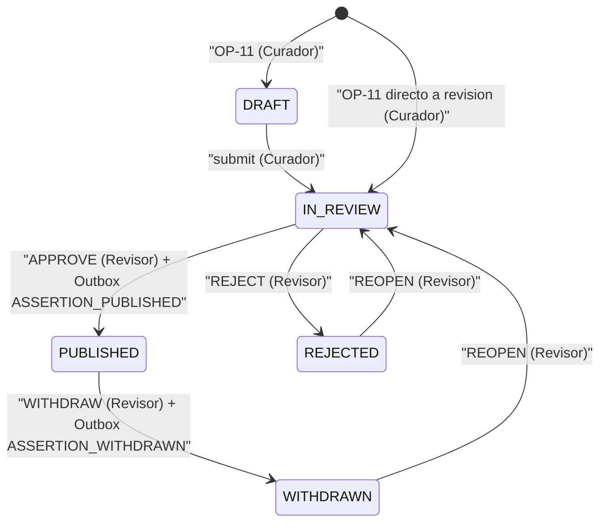
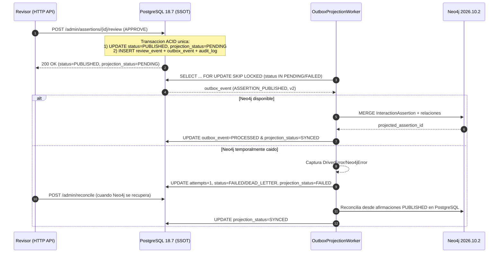
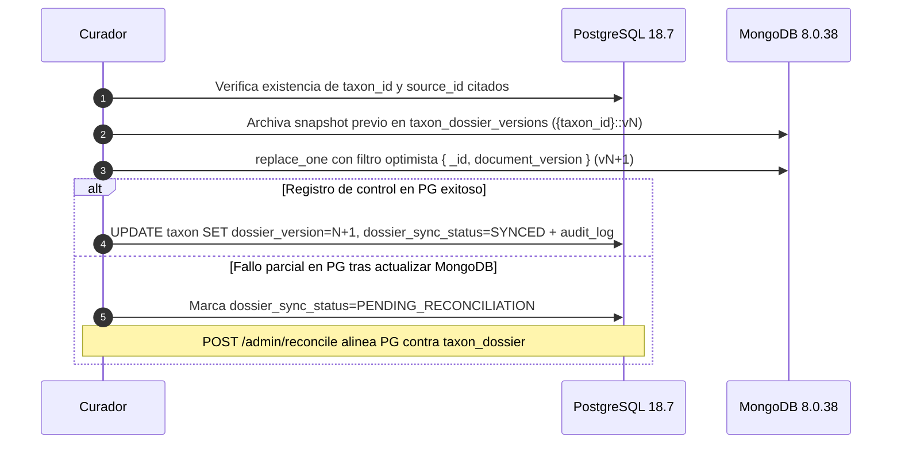

# Arquitectura del Monolito Modular (`biolink-backend`)

## 1. Principio Arquitectónico

`biolink-backend` forma parte de una arquitectura orientada a servicios (SOA) de tres repositorios independientes (`biolink-frontend`, `biolink-backend`, `biolink-benchmarking`). Internamente adopta un **monolito modular con separación estricta de capas** inspirado en arquitectura hexagonal ligera (Puertos y Adaptadores).

- **La API REST no es un proyecto separado:** reside en `src/biolink_backend/api/` bajo el prefijo versionado `/api/v1`.
- **Cero ORM:** se utilizan directamente los drivers oficiales (`psycopg 3`, `pymongo`, `neo4j`) mediante repositorios dedicados por paradigma para aprovechar índices cubrientes parciales en PostgreSQL, `$jsonSchema` en MongoDB y `MERGE` idempotente en Neo4j.

---

## 2. Responsabilidades por Paquete

### Detalle de Módulos
1. **`domain/`:** Núcleo puro en Python sin dependencias hacia FastAPI ni drivers de bases de datos. Implementa las reglas ecológicas de BioLink (`RD-01`–`RD-16`), la máquina de estados (`DRAFT -> IN_REVIEW -> PUBLISHED -> WITHDRAWN`) y la validación de fechas parciales (`RD-09`).
2. **`application/`:** Define contratos (`Protocol`) hacia persistencia y orquesta los casos de uso (`HealthService`, `AuthService`).
3. **`infrastructure/`:** Administra los pools de conexiones, timeouts y el cierre ordenado durante el `lifespan` de FastAPI o del worker.
4. **`repositories/`:**
   - `repositories/relational/`: Consultas SQL parametrizadas sobre PostgreSQL 18.7 (`app_user`, `user_session`, `outbox_event`, sondas de salud).
   - `repositories/document/`: Operaciones nativas PyMongo sobre MongoDB 8.0.38.
   - `repositories/graph/`: Proyecciones idempotentes `MERGE` y retiros segmentados en Cypher (`IN TRANSACTIONS OF 1000 ROWS`) sobre Neo4j 2026.10.2.
5. **`workers/`:** Ejecutable independiente (`python -m biolink_backend.workers.outbox_worker`) dentro del mismo repositorio que consume la tabla `outbox_event` (`FOR UPDATE SKIP LOCKED`) y sincroniza Neo4j sin transacciones distribuidas 2PC.
6. **`api/`:** Expone endpoints REST (`/api/v1`), gestiona `X-Request-ID`, cabeceras de seguridad, CORS restringido y manejo uniforme de errores JSON.

---

## 3. Consistencia entre Modelos (Transactional Outbox y Versionado Documental)

1. **PostgreSQL 18.7** es la única fuente de verdad (SSOT) para identidades canónicas, afirmaciones y estados de publicación.
2. En la misma transacción ACID en PostgreSQL se actualizan los registros científicos (`interaction_assertion`, `review_event`, `audit_log`) y se inserta el evento en `outbox_event (status = 'PENDING')`. Al aprobar (`OP-12`), `projection_status` queda explícitamente en `'PENDING'` (nunca se reporta `'SYNCED'` antes de escribir en Neo4j).
3. El `OutboxProjectionWorker` reclama eventos en lotes ordenados sin bloqueo mutuo (`FOR UPDATE SKIP LOCKED`), deduplica dentro del lote, valida `RD-16` (solo `status == 'PUBLISHED'` se proyecta) y ejecuta `MERGE` idempotente en Neo4j con guarda por `aggregate_version`.
4. En caso de retiro (`ASSERTION_WITHDRAWN`), el worker ejecuta `DETACH DELETE` en Neo4j; si Neo4j falla temporalmente, el evento pasa a `FAILED` con reintento exponencial (`projection_status = 'FAILED'`), y al alcanzar `OUTBOX_MAX_ATTEMPTS` pasa a `DEAD_LETTER` hasta ser reencolado por `POST /api/v1/admin/reconcile`.

### 3.1 Máquina de Estados de `InteractionAssertion` (`OP-11`, `OP-12`)

### 3.2 Secuencia de Publicación Transaccional, Worker y Reconciliación

### 3.3 Flujo Versionado de Expedientes (`OP-13`) en MongoDB + PostgreSQL

